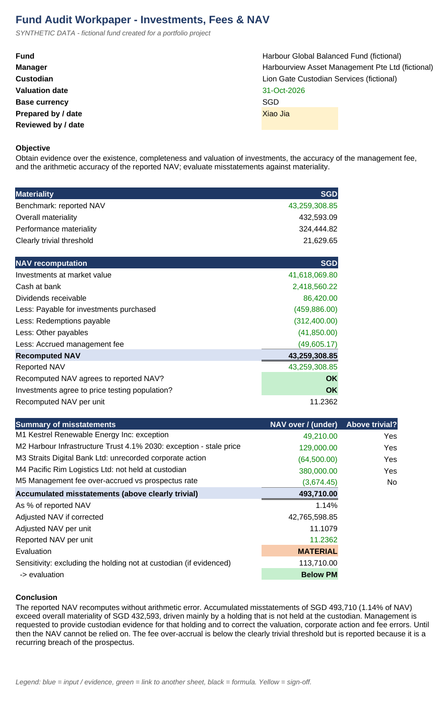

# Fund Audit Procedures — Investments, Fees & NAV

A Python tool that runs year-end audit procedures on an investment fund: it reconciles holdings to the custodian, tests prices against an independent source, recalculates the management fee, recomputes the NAV, and evaluates the misstatements it finds against materiality. The output is an Excel workpaper with live formulas and an audit findings memo.

> **All data is synthetic.** The fund (*Harbour Global Balanced Fund*), its manager, custodian, securities, prices and amounts are fictional and generated by [`scripts/generate_sample_data.py`](scripts/generate_sample_data.py).
>
> Companion project: [bank-reconciliation-automation](https://github.com/XIAOJIA-02/bank-reconciliation-automation) audits the cash of the same fictional fund manager.



---

## Why I built this

Asset and wealth management audits come down to a few questions: do the investments exist, are they valued correctly, are the fees charged in line with the prospectus, and is the NAV that investors buy and sell at right? I built this project to practise those procedures end to end on a realistic fund, and to show how each finding is weighed against materiality before reaching a conclusion.

## Procedures

| # | Procedure | Assertion | What the tool does |
|---|---|---|---|
| 1 | **Custodian reconciliation** | Existence, completeness | Compares the fund's holdings with the custodian statement, then explains differences using unsettled trades and corporate actions |
| 2 | **Price testing** | Valuation | Compares each fund price with an independent price (1% tolerance) and flags stale prices (older than 5 days) |
| 3 | **Management fee recalculation** | Accuracy | Recalculates the daily accrual (net assets × rate ÷ 365) and compares it with the fee the manager accrued |
| 4 | **NAV recomputation** | Accuracy | Rebuilds the NAV from its components and agrees it to the reported NAV and NAV per unit |
| 5 | **Misstatement evaluation** | — | Accumulates misstatements above *clearly trivial* and compares them with overall and performance materiality |

## Results on the sample data

The reported NAV is **SGD 43,259,308.85** (SGD 11.2362 per unit), and it recomputes without arithmetic error. The procedures found every planted exception:

| Ref | Finding | Assertion | NAV over / (under) SGD | Rating |
|---|---|---|---:|---|
| F1 | A holding is in the books but **not at the custodian**, and no trade explains it | Existence | 380,000.00 | High |
| F2 | A bond is priced **31 days stale** and 4.6% above the independent price | Valuation | 129,000.00 | High |
| F3 | Management fee accrued at **1.35%** instead of the prospectus rate of 1.25% | Accuracy | (3,674.45) | High |
| F4 | An equity is priced 4.1% above the independent price | Valuation | 49,210.00 | Medium |
| F5 | A 1-for-10 **bonus issue** was received at the custodian but not booked | Completeness | (64,500.00) | Medium |
| F6 | A purchase traded on 30 Oct settles on 3 Nov | Cut-off | — | Low |

**Evaluation**

| | SGD |
|---|---:|
| Overall materiality (1% of NAV) | 432,593.09 |
| Performance materiality (75%) | 324,444.82 |
| Clearly trivial (5%) | 21,629.65 |
| **Accumulated misstatements** | **493,710.00** (1.14% of NAV) → **MATERIAL** |
| If the custodian holding is evidenced | 113,710.00 → below performance materiality |
| Adjusted NAV per unit | 11.1079 (reported 11.2362) |

Three judgements are built into the result:
- **The unsettled purchase is not a misstatement.** Funds account for trades on trade date, so the books are right and the custodian is just behind. This is a timing difference, tested by tracing settlement in November.
- **The fee error is below clearly trivial, but it is still rated High.** It is quantitatively small yet qualitatively significant: investors are overcharged every month, and the rate breaches the prospectus.
- **One item drives the conclusion.** Without the unsupported holding, the remaining misstatements fall below performance materiality, so custodian confirmation is the first thing to obtain.

## The Excel workpaper

`output/fund_audit_workpaper_oct2026.xlsx`

| Sheet | Contents |
|---|---|
| **Summary** | Sign-off box, objective, materiality, NAV recomputation, misstatement schedule linked to the detail sheets, evaluation and conclusion |
| **Findings** | Audit findings memo: observation, assertion, amount, rating, recommendation, and a column for management's response |
| **Price Testing** | Market values per fund vs independent source, % difference, stale check and exception flags, all as formulas |
| **Custodian Rec** | Books vs custodian quantities, expected differences pulled from the evidence sheet, unexplained differences valued at independent prices |
| **Mgmt Fee** | Daily fee recalculation for October, implied rate, over-accrual |
| **NAV Statement** | The administrator's reported NAV (input) |
| **Assumptions** | Tolerance, stale days, materiality percentages, fee rate and FX rates. Change any of them and the workpaper recalculates |
| **Evidence** | Pending trade confirmation and corporate action notice |

Colour convention: blue = input or evidence, green = link to another sheet, black = formula.

## How to run

You need **Python 3.9+**.

```bash
# 1. Install dependencies
pip install -r requirements.txt

# 2. (Optional) regenerate the synthetic data
python scripts/generate_sample_data.py

# 3. Run the procedures
python main.py --preparer "Your Name"

# Options
python main.py --tolerance 0.02        # price tolerance of 2%
python main.py --materiality 0.005     # overall materiality of 0.5% of NAV

# 4. Run the tests
python -m pytest -v
```

## Project structure

```
fund-audit-procedures/
├── fundaudit/
│   ├── procedures.py      # custodian rec, price testing, fee recalc, NAV, materiality, findings
│   └── workpaper.py       # Excel workpaper export with live formulas
├── data/                  # synthetic holdings, custodian statement, prices, trades, NAV
├── docs/                  # screenshot used in this README
├── output/                # generated workpaper and CSV reports
├── scripts/
│   └── generate_sample_data.py
├── tests/
│   └── test_procedures.py # 10 tests against the known answer key
├── main.py
└── requirements.txt
```

## Limitations

- **Simplified fund.** One share class, one valuation date, no performance fee, no equalisation or swing pricing.
- **Fee test covers one month.** A real audit would test the full year, or use analytical review on the full-year fee.
- **Single price source.** Real price testing uses more than one vendor and a separate approach for Level 3 (hard-to-value) assets.
- **Materiality percentages are illustrative.** In practice materiality is set by professional judgement for each engagement.
- **It does not replace judgement.** The tool finds and measures exceptions. Deciding what they mean and what to ask management still needs an auditor.

## License

MIT, see [LICENSE](LICENSE).
